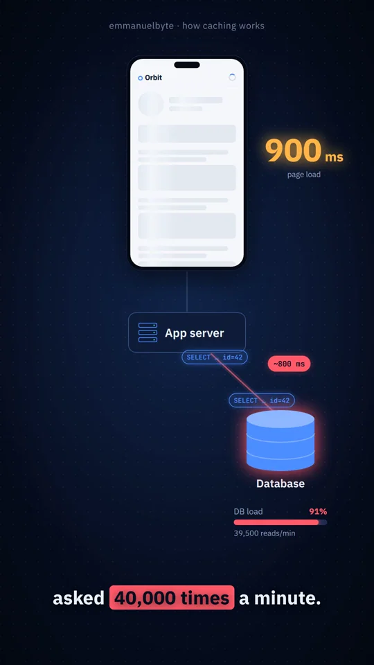
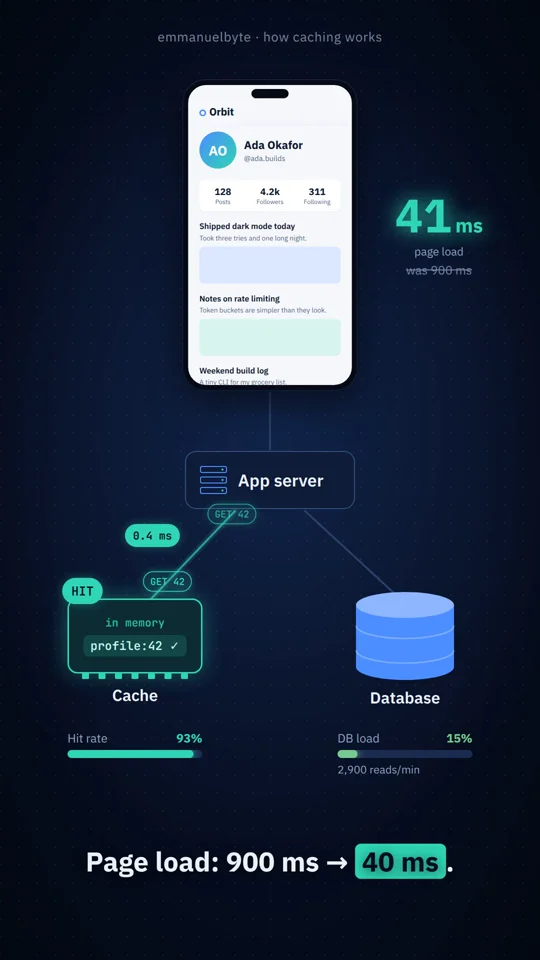

# Caching hero shot: approved reference render (2026-10-22)

Our own render of `src/remotion/hero/` (no third-party assets). This is the
visual bar for lessons. Regenerate with `npm run hero:render`.

- [caching-hero.mp4](caching-hero.mp4): 1080×1920, 30 fps, 30 s, no audio yet

| Time | Still | Beat |
| --- | --- | --- |
| 2 s |  | Hook: page load counts up to 900 ms |
| 7 s |  | The same query floods the database (92% load) |
| 15 s |  | First request: miss → database → save a copy |
| 22 s |  | Hits from memory; DB load falls; page loads |
| 28 s |  | Payoff 40 ms and the stale-data cliffhanger |
