# Reference Video Screenshots (2026-10-22)

**Purpose:** Visual-analysis evidence for Tech Explainer Studio. Use with [the visual benchmark](../2026-10-22-VISUAL-REFERENCE-BENCHMARK.md) and [the authoring guide](../AUTHORING_GUIDE.md).

**Reference:** User-provided vertical explainer *“Replication vs Partitioning vs Sharding: When to Use Each”*, credited in the source video to **CodewithIddris** (the source watermark also shows a TikTok handle). Approximately 9m39s; original upload was 576×1024 at 24 fps. These are **small, recompressed excerpts** for commentary and comparison, not the original media. The file was uploaded privately in our project conversation; no public canonical source URL has been independently verified.

**Rights and use:** Original visuals remain the creator's work. Attribution and watermark are preserved in the screenshots. These reduced-resolution stills are provided only as source-identifying visual examples alongside critical design commentary. Their inclusion does not grant us reuse rights. **Do not redistribute them in published lessons, copy their UI assets or branding, train a generative model on them, or treat them as production assets.** Make original fictional application UIs, icons, and diagrams. If any rights holder objects to public repository hosting, remove the images and retain the text analysis.

## Four contact sheets

Each sheet represents twelve sampled frames, spaced around 12 seconds apart. Timestamps are from the source video, not our production timeline.

### Sheet 1: 00:06–02:18, introduction / app / replication

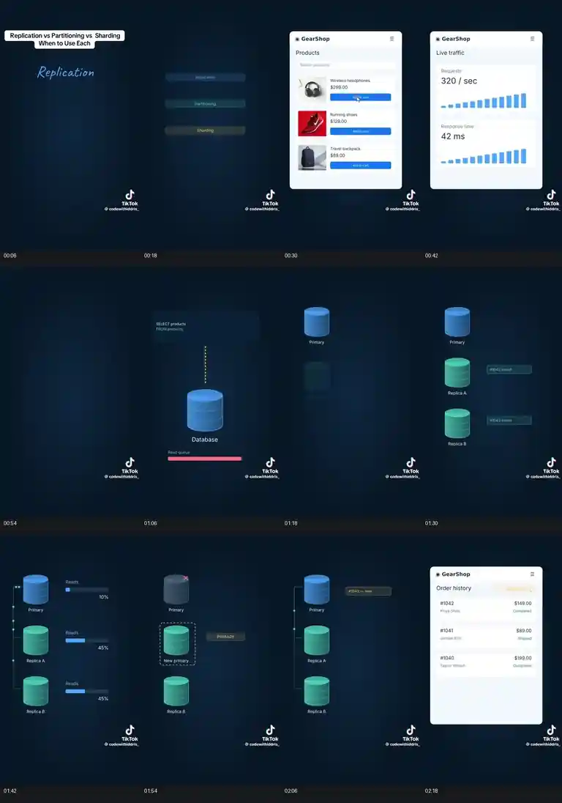

**Observe:** Gradual title introduction, a believable app interface, rising traffic, read queue, primary/replica cylinders, distribution bars, failure icon and a visibly promoted replacement primary. **Our learning:** connect the *user request* to the *system event* and show the consequence.

### Sheet 2: 02:30–04:42, orders / indexes / partitions

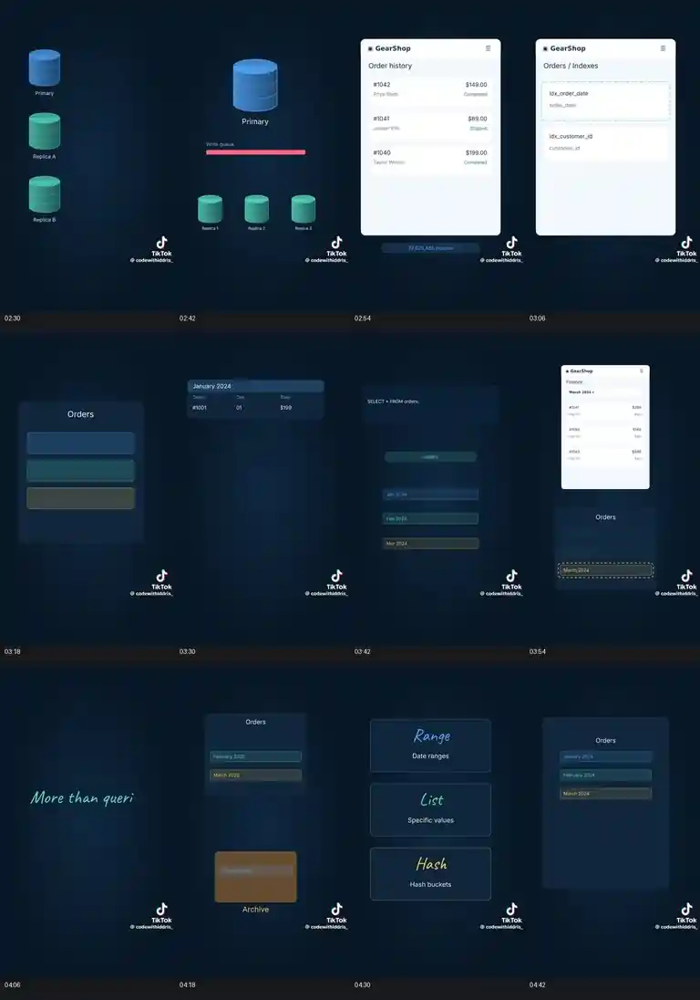

**Observe:** Stable, consistent e-commerce app mockup paired with database tables and partition lists. Dashed outlines focus the active subset rather than simply listing definitions. **Our learning:** use data-organization primitives that are genuinely connected to query behavior.

### Sheet 3: 04:54–07:06, compare concepts / distribute shards

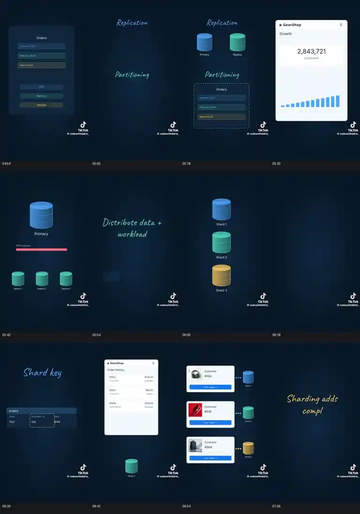

**Observe:** Written headings and database illustrations introduce each concept; the growing app workload leads to three distinct shard cylinders and customer-to-shard routing. **Our learning:** retain the same running example while explaining different scaling techniques.

### Sheet 4: 07:18–09:30, hot shard / data locality / combined architecture / decision

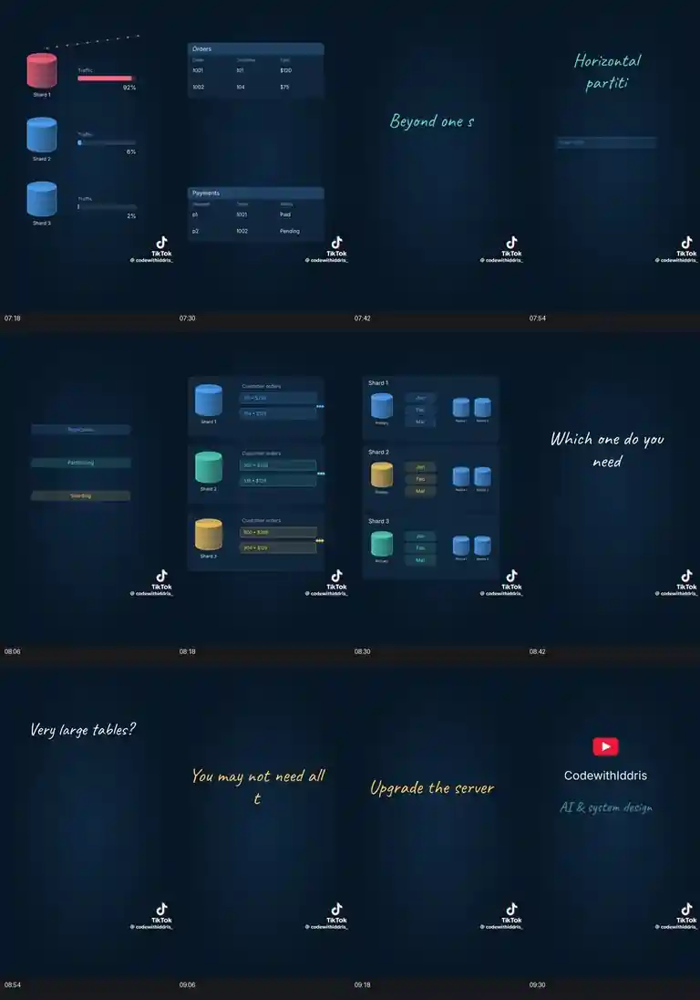

**Observe:** A strongly skewed traffic chart; two related tables; and an architecture combining shards, per-shard replicas and partitions. The outro changes pace and typography. **Our learning:** show drawbacks and combinations, not only happy-path diagrams.

## Selected individual screenshots

These shots are kept separately so an agent can inspect scene composition at greater detail than the overview sheets. Each capture is near the named timestamp; a still alone **cannot establish** how a transition was animated.

| Timestamp | Screenshot | What to study and reproduce originally |
| --- | --- | --- |
| ~00:30 | [Application products](00-30-app-products.webp) | Bright fictional application UI against dark technical canvas; product tiles, buttons, recognizable action |
| ~01:42 | [Replica read distribution](01-42-replica-reads.webp) | Primary plus replicas, semantic blue/teal color assignments, measurable read distribution, traffic indicators |
| ~01:54 | [Replica failover](01-54-replica-failover.webp) | Failure marking and new-primary promotion with persistent node positions |
| ~03:54 | [Partition pruning](03-54-partition-pruning.webp) | An app's selected date range correspondingly highlights an active data partition |
| ~04:30 | [Partition strategies](04-30-partition-types.webp) | Compact range/list/hash comparison with handwritten accent headings |
| ~06:30 | [Shard-key mapping](06-30-shard-key.webp) | Highlight the chosen field and the shard to which an example record maps |
| ~06:54 | [Customer routing](06-54-customer-routing.webp) | Customer-specific UI data visibly routed to differently colored shards |
| ~07:18 | [Hot-shard skew](07-18-hot-shard.webp) | Traffic concentration as a concrete drawback; meaningful numeric distribution |
| ~08:30 | [Combined architecture](08-30-combined-architecture.webp) | Shards + partitions + replicas composed coherently without a cluttered spaghetti diagram |

### Application and replicas

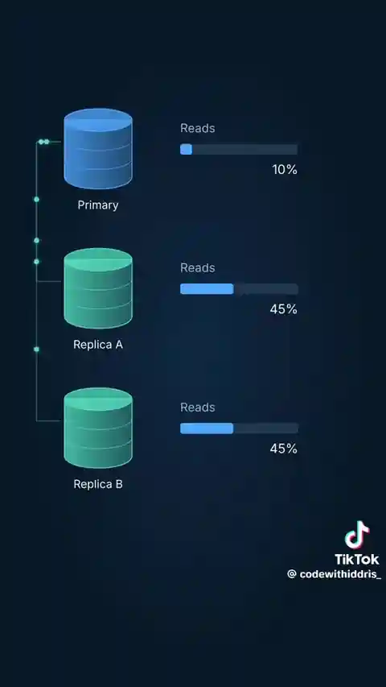
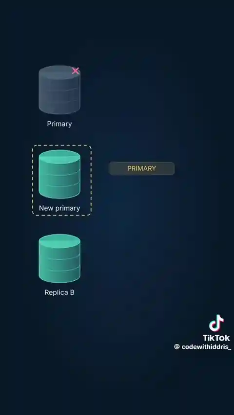

### Partitioning

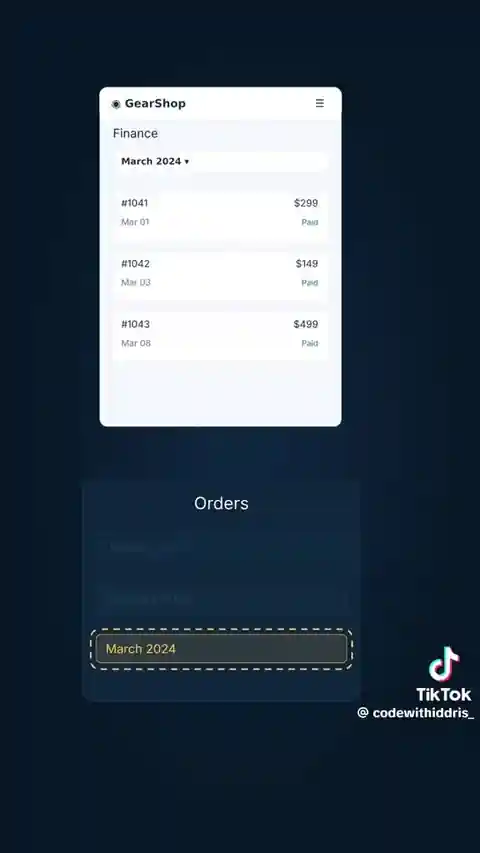
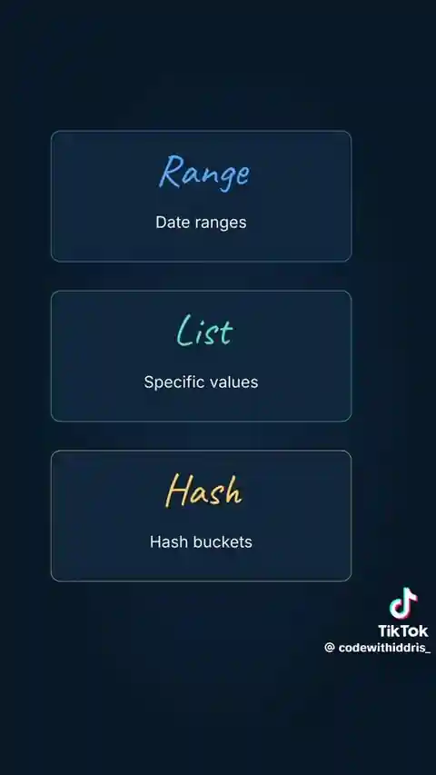

### Sharding, skew and combination

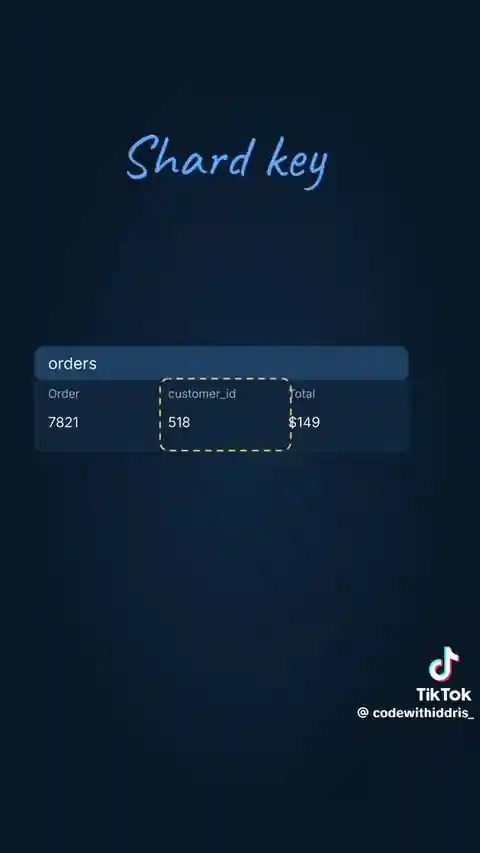
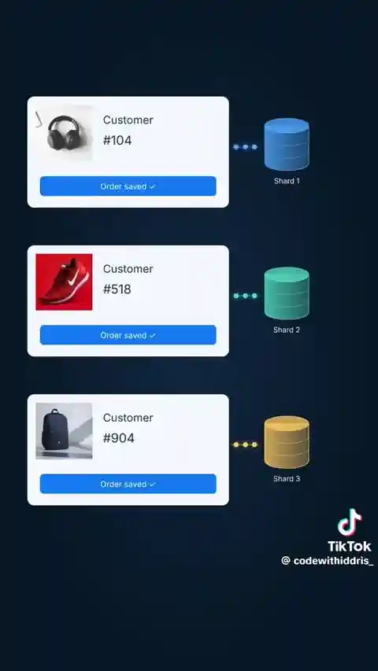
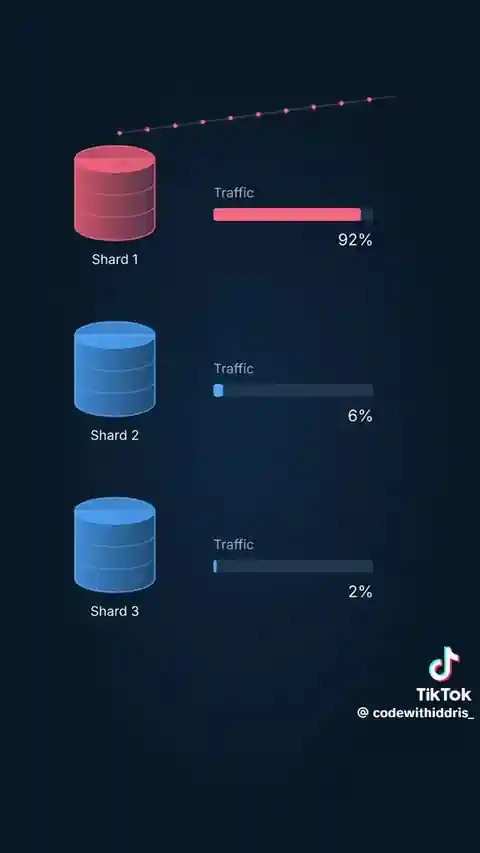
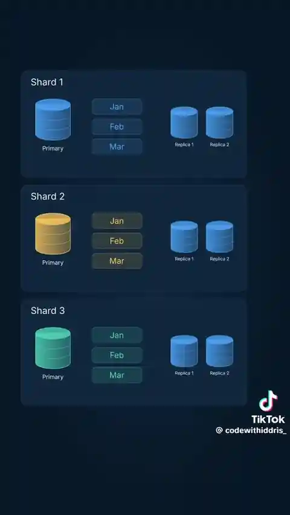

## Practical production rules derived from these screenshots

1. **Design a running application state machine before drawing components.** Each user action changes a visible UI state and at least one backend state, when applicable.
2. **Animate causality, not decoration.** A request travels, a query uses a partition, or a replica is promoted because a failure has occurred and been detected.
3. **Use intentional contrast and typography.** The UI is brighter and uses conventional legible interface type; architecture sits on a dark field; handwriting is reserved for short headings and annotations.
4. **Preserve spatial continuity where possible.** Showing a problem, then overlaying the fix on the same layout, is easier to follow than jumping to a separate static slide.
5. **Keep information dense only where legible.** Portrait requires foreground prioritization and layout recomposition; landscape should have its own deliberately balanced arrangement.
6. **Inspect motion, not just these stills.** For each critical moment, view a before/during/after frame sequence and listen to synchronized narration.
7. **Teach the mechanism accurately.** For example, a replica cannot automatically accept writes merely because the primary failed; promotion and application routing require an explicit story and conditions.

## Where these files belong

This entire folder is **design evidence only**. The lesson engine must not load from `docs/visual-references/` at runtime. New visuals must live in the project's normal, original, licensed asset/scene system. The original uploaded video is intentionally **not committed**.

## Six additional reference videos (2026-10-22)

The [six-video annotated reference library](extra-six/README.md) adds **36 timestamped screenshots**, **six contact sheets**, an [all-six overview](extra-six/ALL_SIX_OVERVIEW.webp), and a machine-readable [manifest](extra-six/manifest.json). All seven references (CodewithIddris and these six) carry equal weight. Techniques from every video are catalogued together in [TECHNIQUES.md](TECHNIQUES.md); our own house style comes from the approved hero shot in `src/remotion/hero/`.

| Creator/video | Technique to study | Frames |
| --- | --- | --- |
| Kuls Tech — Kernel | layered system diagrams and semantic colour | [View](extra-six/01-kuls-tech-kernel/contact_sheet.webp) |
| So That's How — Wi-Fi | spatial continuity, obstacles and wave motion | [View](extra-six/02-so-thats-how-wifi/contact_sheet.webp) |
| Rick — Computer Vision | evolving application states and visual data processing | [View](extra-six/03-rick-computer-vision/contact_sheet.webp) |
| Rick — System Design 101 | architecture evolution from product requirements | [View](extra-six/04-rick-system-design/contact_sheet.webp) |
| KodeKloud — TCP/TLS/HTTP | ordered protocol messages and layered networking | [View](extra-six/05-kodekloud-http-tls/contact_sheet.webp) |
| KodeKloud — Authentication | login, sessions, tokens, expiration and security state | [View](extra-six/06-kodekloud-auth/contact_sheet.webp) |

Use the reduced-size third-party screenshots only for attributed commentary and analysis. Preserve watermarks and make **original** production assets. No third-party source videos have been committed.
