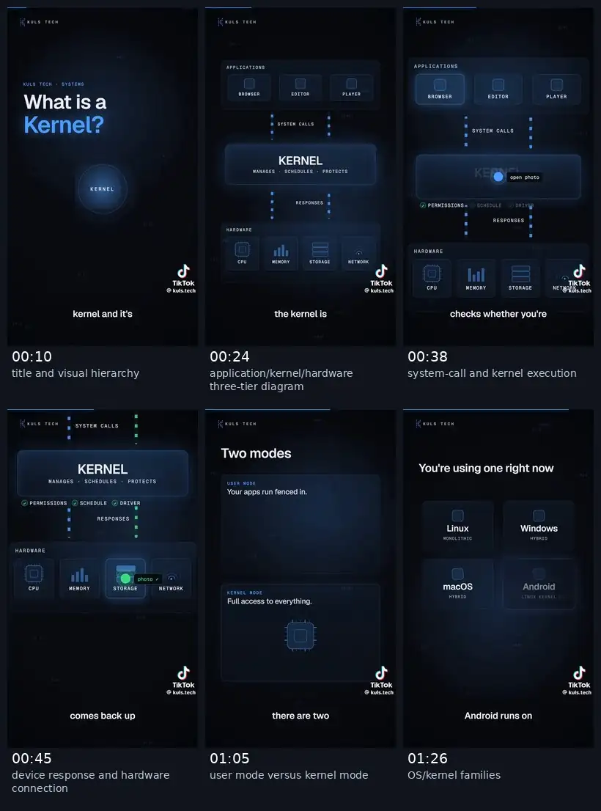
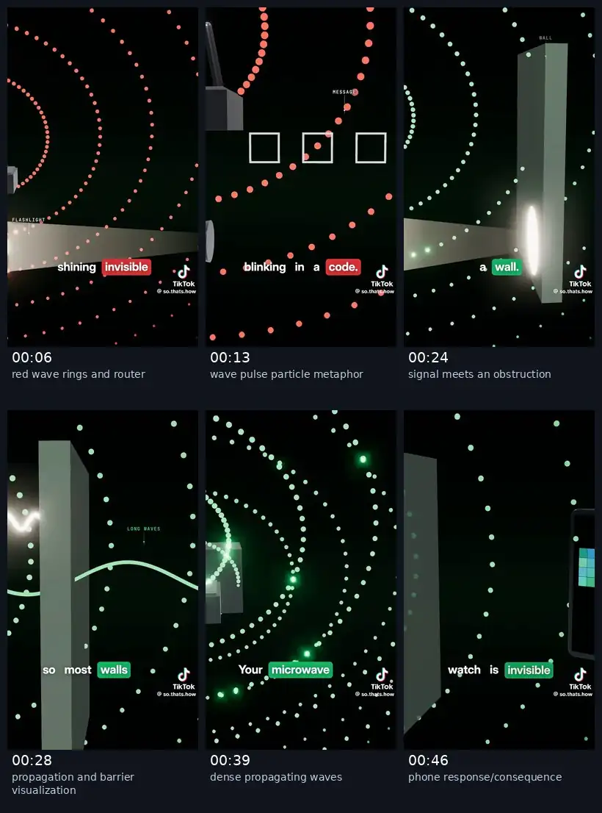
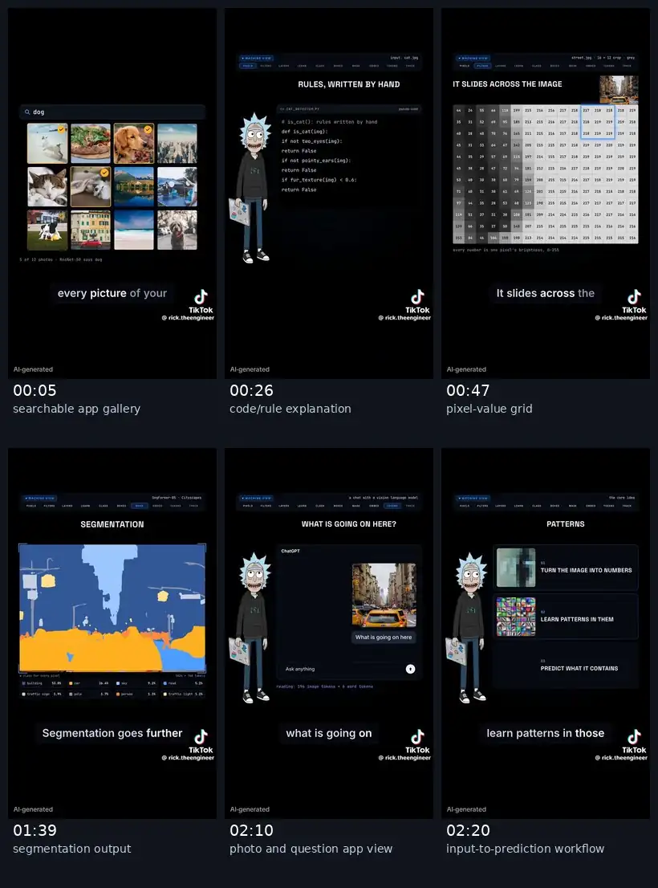
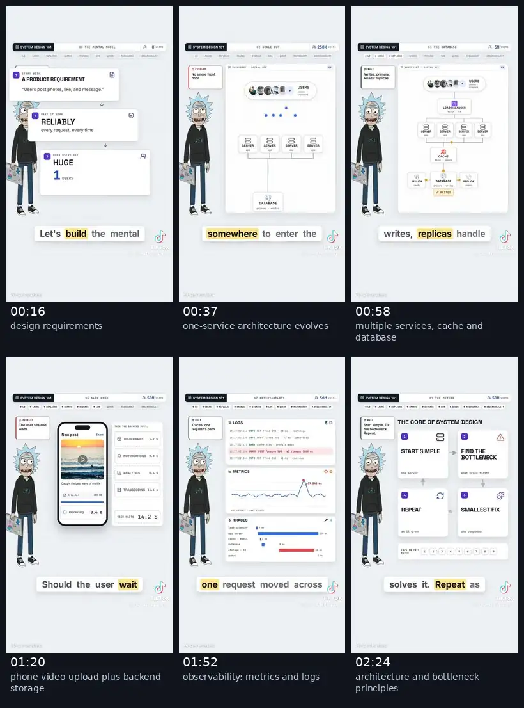
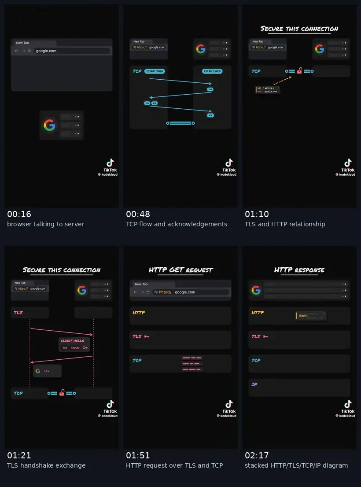
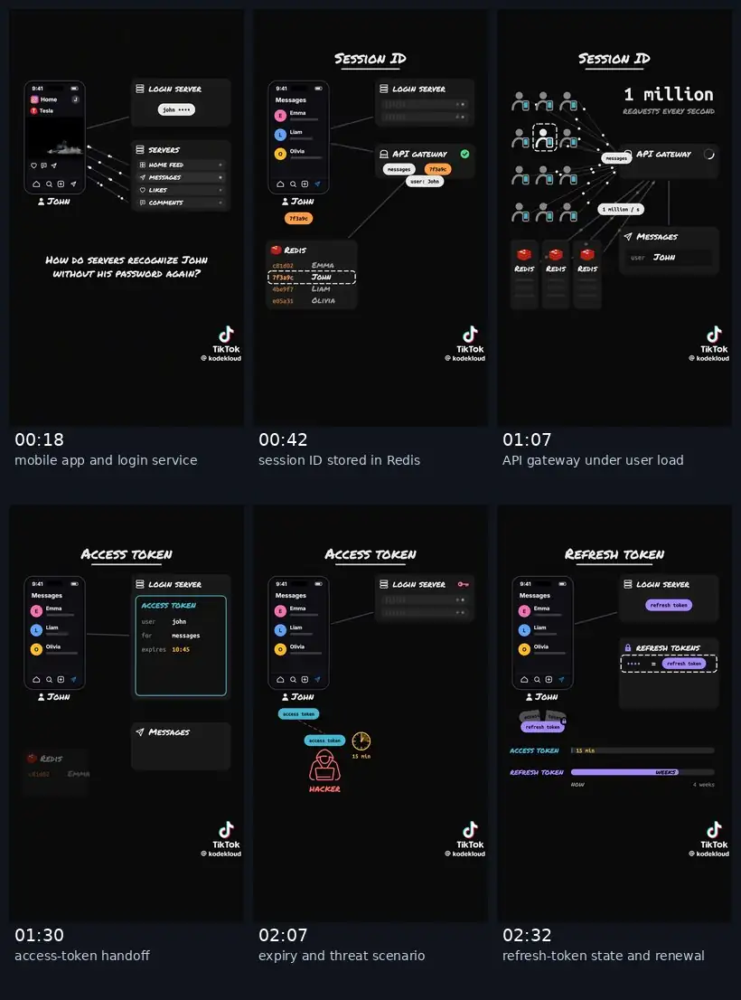

# Engineering Explained — Six Video Reference Snapshots

Generated 2026-10-22 from six user-provided video files. All screenshots are **actual extracted frames**, not image-search results, stock artwork, or synthetic reconstructions.

**Rights and use:** These are reduced-size, attributed screenshots from third-party videos provided by the user, included solely as timestamped critical/educational design commentary. Copyright remains with the respective owners. Keep visible credits/watermarks; do not reuse frames as source assets, remove attribution, redistribute the source videos, or imply affiliation. Public repository inclusion does not establish a license for other uses; promptly review/remove if a rights holder objects.

**Scope:** Screenshots and visual review only; no frame-by-frame animation analysis, narration transcription, or guarantee of technical correctness.

## Triage

| Priority | Reference | What to learn |
| --- | --- | --- |
| Very high | 04 System Design 101 | Product-led end-to-end architecture narrative |
| Very high | 05 TCP/TLS/HTTP | Protocol flow choreography, anchored message movement |
| Very high | 06 Authentication | Stateful UI↔backend sequences and security edge cases |
| High | 03 Computer Vision | Dynamic application UIs and data visualization |
| Medium | 01 Kernel | Visual minimalism, layering, semantic color |
| Selective | 02 Wi-Fi | Motion/depth and visual metaphor, costly if 3D |

## Per-video frames

The contact sheet for each clip arranges six representative moments in timestamp order. Six representative frames (converted to WebP to reduce repository size) are in each folder. The original user-provided video files are **not** committed.

### Kuls Tech | Kernel (103.1 seconds)

**Observations:** Dark navy palette; crisp boxes; progressive build-up of process boundaries. Weakness: much of the runtime uses the same central composition. Reuse its simplicity, avoid static-looking scenes.

| Timestamp | Snapshot | What to inspect |
| --- | --- | --- |
| 00:10 | [01_00m10s.webp](01-kuls-tech-kernel/01_00m10s.webp) | title and visual hierarchy |
| 00:24 | [02_00m24s.webp](01-kuls-tech-kernel/02_00m24s.webp) | application/kernel/hardware three-tier diagram |
| 00:38 | [03_00m38s.webp](01-kuls-tech-kernel/03_00m38s.webp) | system-call and kernel execution |
| 00:45 | [04_00m45s.webp](01-kuls-tech-kernel/04_00m45s.webp) | device response and hardware connection |
| 01:05 | [05_01m05s.webp](01-kuls-tech-kernel/05_01m05s.webp) | user mode versus kernel mode |
| 01:26 | [06_01m26s.webp](01-kuls-tech-kernel/06_01m26s.webp) | OS/kernel families |

### So Thats How | Wi-Fi (55.4 seconds)

**Observations:** Excellent spatial storytelling and strong continuity from source to obstacles to a receiving device. Physical analogies need careful technical fact-checking; 3D work is optional.

| Timestamp | Snapshot | What to inspect |
| --- | --- | --- |
| 00:06 | [01_00m06s.webp](02-so-thats-how-wifi/01_00m06s.webp) | red wave rings and router |
| 00:13 | [02_00m13s.webp](02-so-thats-how-wifi/02_00m13s.webp) | wave pulse particle metaphor |
| 00:24 | [03_00m24s.webp](02-so-thats-how-wifi/03_00m24s.webp) | signal meets an obstruction |
| 00:28 | [04_00m28s.webp](02-so-thats-how-wifi/04_00m28s.webp) | propagation and barrier visualization |
| 00:39 | [05_00m39s.webp](02-so-thats-how-wifi/05_00m39s.webp) | dense propagating waves |
| 00:46 | [06_00m46s.webp](02-so-thats-how-wifi/06_00m46s.webp) | phone response/consequence |

### Rick | Computer Vision (156.4 seconds)

**Observations:** UI-rich explainer with typed data, selection states and image processing panels. Reuse contextual state transitions and the labeled processing stages; avoid persistent distracting avatar and illegibly tiny grids.

| Timestamp | Snapshot | What to inspect |
| --- | --- | --- |
| 00:05 | [01_00m05s.webp](03-rick-computer-vision/01_00m05s.webp) | searchable app gallery |
| 00:26 | [02_00m26s.webp](03-rick-computer-vision/02_00m26s.webp) | code/rule explanation |
| 00:47 | [03_00m47s.webp](03-rick-computer-vision/03_00m47s.webp) | pixel-value grid |
| 01:39 | [04_01m39s.webp](03-rick-computer-vision/04_01m39s.webp) | segmentation output |
| 02:10 | [05_02m10s.webp](03-rick-computer-vision/05_02m10s.webp) | photo and question app view |
| 02:20 | [06_02m20s.webp](03-rick-computer-vision/06_02m20s.webp) | input-to-prediction workflow |

### Rick | System Design 101 (159.5 seconds)

**Observations:** Strongest full product-to-architecture teaching narrative. White template competes with existing dark aesthetic and labels are tiny on mobile; borrow modular layout and progression, not exact graphics or avatar.

| Timestamp | Snapshot | What to inspect |
| --- | --- | --- |
| 00:16 | [01_00m16s.webp](04-rick-system-design/01_00m16s.webp) | design requirements |
| 00:37 | [02_00m37s.webp](04-rick-system-design/02_00m37s.webp) | one-service architecture evolves |
| 00:58 | [03_00m58s.webp](04-rick-system-design/03_00m58s.webp) | multiple services, cache and database |
| 01:20 | [04_01m20s.webp](04-rick-system-design/04_01m20s.webp) | phone video upload plus backend storage |
| 01:52 | [05_01m52s.webp](04-rick-system-design/05_01m52s.webp) | observability: metrics and logs |
| 02:24 | [06_02m24s.webp](04-rick-system-design/06_02m24s.webp) | architecture and bottleneck principles |

### KodeKloud | TCP, TLS and HTTP (161.6 seconds)

**Observations:** Best reference for timing data packets, sequence diagrams and preserving protocol layers through transitions. Restrained dark setting and semantic blue/pink/orange colors. Verify details before copying any protocol claims.

| Timestamp | Snapshot | What to inspect |
| --- | --- | --- |
| 00:16 | [01_00m16s.webp](05-kodekloud-http-tls/01_00m16s.webp) | browser talking to server |
| 00:48 | [02_00m48s.webp](05-kodekloud-http-tls/02_00m48s.webp) | TCP flow and acknowledgements |
| 01:10 | [03_01m10s.webp](05-kodekloud-http-tls/03_01m10s.webp) | TLS and HTTP relationship |
| 01:21 | [04_01m21s.webp](05-kodekloud-http-tls/04_01m21s.webp) | TLS handshake exchange |
| 01:51 | [05_01m51s.webp](05-kodekloud-http-tls/05_01m51s.webp) | HTTP request over TLS and TCP |
| 02:17 | [06_02m17s.webp](05-kodekloud-http-tls/06_02m17s.webp) | stacked HTTP/TLS/TCP/IP diagram |

### KodeKloud | Authentication (182.0 seconds)

**Observations:** Best reference for stateful security sequences: app, auth service, Redis, sessions, tokens, expiry, attacker states. Keep independent UI and backend states readable and revisit the same elements across scenes.

| Timestamp | Snapshot | What to inspect |
| --- | --- | --- |
| 00:18 | [01_00m18s.webp](06-kodekloud-auth/01_00m18s.webp) | mobile app and login service |
| 00:42 | [02_00m42s.webp](06-kodekloud-auth/02_00m42s.webp) | session ID stored in Redis |
| 01:07 | [03_01m07s.webp](06-kodekloud-auth/03_01m07s.webp) | API gateway under user load |
| 01:30 | [04_01m30s.webp](06-kodekloud-auth/04_01m30s.webp) | access-token handoff |
| 02:07 | [05_02m07s.webp](06-kodekloud-auth/05_02m07s.webp) | expiry and threat scenario |
| 02:32 | [06_02m32s.webp](06-kodekloud-auth/06_02m32s.webp) | refresh-token state and renewal |

## Design implications for tech-explainer-studio

1. Continue to use the first CodewithIddris reference as the core dark, app-driven visual identity; blend in selected techniques without turning the output into a collage of other creators’ aesthetics.
2. Keep a persistent state model for visible application UI and corresponding infrastructure actors (browser/mobile, API, load balancer, database, Redis, storage). A tap must visibly trigger a request and response.
3. Extend the scene vocabulary only for confirmed limitations: app screens with changing state, tables/counters, routed packets/tokens, protocol lanes, and stateful transitions. Try a representative scene with the existing deterministic Remotion/lesson compiler first.
4. Prioritize legibility in vertical, purposeful motion and hold times, meaningful failure/recovery, and narration alignment. A set of valid stills cannot establish animation quality.
5. Apply user-approved script gate before production; reference snapshots never authorize rewriting narration or publishing copied assets.

## What still needs assessment

- Review actual video motion near the selected timestamps rather than relying only on the contact sheets.
- Listen critically to audio, pacing and use of sound effects before treating them as quality standards.
- Cross-check specific system-design/security assertions before making a teaching script.
- Only promote reference images into a **public** GitHub repository after checking their copyright/licensing implications.

## Repository integration and provenance

- Location: `docs/visual-references/extra-six/`; earlier CodewithIddris reference remains the primary benchmark.
- The screenshots are **actual sampled frames** from the six uploaded clips, converted to WebP for repository-size control. They were not generated or redrawn by AI.
- Each title/timestamp is grounded in the supplied clips. The images document visual techniques, **not** the correctness of technical claims in the narrations.
- For each video, study motion and transitions by inspecting the associated supplied video where legally available. A still alone does not show choreography.
- No production code or approved narration was modified by adding these references.